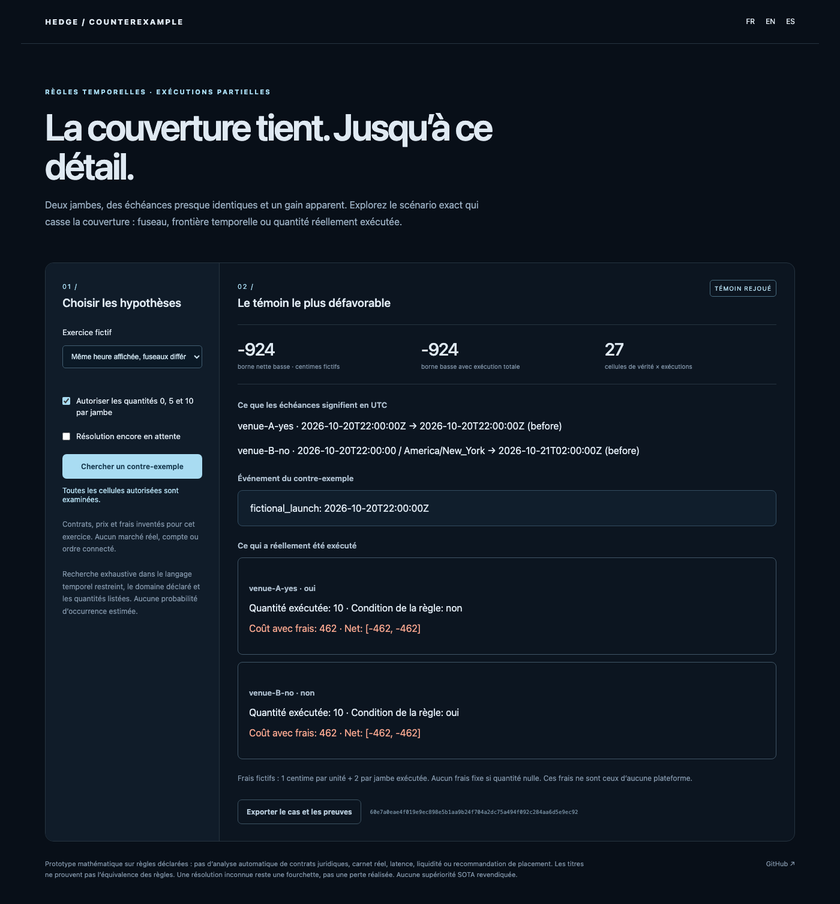

# Hedge Counterexample

[Français](README.md) · [English](README.en.md)

**Encontrar el escenario exacto en que una cobertura aparentemente complementaria deja de cubrir.**

Títulos similares no garantizan reglas idénticas ni la ejecución de ambas posiciones. El laboratorio verifica predicados temporales declarados y cantidades ejecutadas explícitas; exporta un testigo reproducible con aritmética de céntimos enteros.

## Probar

Python 3.11+; biblioteca estándar, sin clave ni conexión a plataforma.

```sh
git clone https://github.com/gbesse/hedge-counterexample
cd hedge-counterexample
python3 -m hedge_counterexample serve --lang es
```

Abrir `http://127.0.0.1:8773/?lang=es`. Dos ejercicios totalmente **ficticios**:

- **Zonas distintas**: comprar sí antes de las 22 UTC y no antes de las 22 en Nueva York no cubre un evento entre ambos plazos. Con diez unidades por posición y costes/comisiones declarados, el peor neto resuelto es **−924 céntimos ficticios**.
- **Ejecuciones parciales**: con reglas idénticas, la ejecución completa de ambas posiciones da un mínimo de **+76**. Permitir independientemente 0, 5 o 10 unidades produce un peor caso de **−462**, cuando solo se ejecuta una posición.

Activar resolución pendiente conserva un **intervalo neto**, no una pérdida realizada: diez unidades en cada posición dan `[−924, 1076]`, coste comprometido no resuelto 924. `settled_net_cents` queda `null`. No implica probabilidad ni recomendación.



```sh
python3 -m hedge_counterexample demo > analisis.json
python3 -m hedge_counterexample analyze hedge_counterexample/examples/partial-fill-gap.json
python3 -m hedge_counterexample verify caso.json testigo.json
```

La exportación contiene `source_case` y `worst`; guardar esos objetos por separado para `verify`. `pip install .` instala también `hedge-counterexample`. Interfaz y errores FR/EN/ES; datos del usuario sin cambios.

## Alcance exacto

Los contratos pagan 100 céntimos por unidad ganadora, con sí/no, precio entero, comisión por unidad y comisión fija si se ejecuta al menos una unidad. Comisiones **inventadas**: 1 céntimo por unidad + 2 por posición ejecutada; sin comisión fija con cantidad cero. No implementa tarifas de plataforma.

El lenguaje admite `before`, `at_or_before`, `not`, `and`, `or` sobre eventos fechados, opcionalmente ausentes. Cada evento tiene dominio explícito de segundos UTC enteros. Plazos con UTC/offset explícito u hora local + zona IANA. Horas inexistentes se rechazan; horas ambiguas de otoño exigen `fold: 0` o `fold: 1`.

La búsqueda examina extremos del dominio y segundos alrededor de cada plazo; agrupa vectores de verdad atómica idénticos. Esas celdas bastan **para este lenguaje restringido**. El producto con cantidades declaradas encuentra el peor neto o límite inferior. La exhaustividad excluye reglas y cantidades omitidas. Límites: tres eventos, seis contratos, veinte predicados atómicos, cinco cantidades por contrato, 100 000 pruebas. El verificador repite el mismo motor de reglas y cálculo; no es prueba independiente de exhaustividad.

## Trabajos previos y límites

[Polymarket documenta ejecuciones totales y parciales](https://docs.polymarket.com/trading/place-orders) y [resolución según reglas predefinidas](https://help.polymarket.com/en/articles/13364518-how-are-prediction-markets-resolved). Motivan el problema; no se redistribuye texto contractual real. Nuestro [jev-contract-graph](https://github.com/gbesse/jev-contract-graph) ya explora relaciones entre contratos. Aquí se enfoca **testigo temporal normalizado + cantidad ejecutada + comisiones + resolución desconocida**, sin recopilar mercados.

Contratos inventados, no arbitraje real. Sin interpretación automática de contratos jurídicos, API de trading, libro real, divisas, latencia, capital requerido, liquidez, impacto de mercado ni recomendación de inversión. Los valores no son pronósticos. Sin superioridad SOTA, rentabilidad real ni adopción humana afirmadas.

## Verificar

```sh
python3 -m unittest discover -s tests -v
npm ci
npx playwright install chromium
npm run test:browser
npm run format:check
```

Trece pruebas: límites inclusivos, horario estacional, horas ambiguas/inexistentes, comisiones, cero ejecuciones, intervalos pendientes y testigos alterados. Celdas críticas comparadas con enumeración segundo a segundo en veinte casos aleatorios pequeños. Navegador FR/EN/ES, ambos ejercicios, ejecuciones parciales/totales, espera, exportación y móvil. CI Python 3.11/3.12 y rueda fuera de fuentes. MIT; alfa pública.
